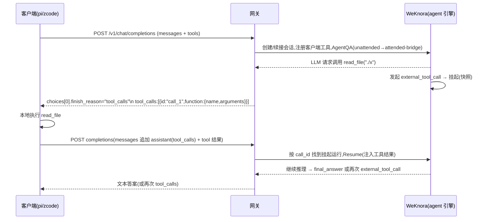

# 智能体模型网关 M2/M3:发布治理、会话语义与工具透传

状态:M2 全部已实现(M1 已落地)　关联:`docs/design/agent-model-gateway-m1.md`、`docs/design/agent-hitl-suspend-resume.md`、`docs/design/agent-permission-model.md`

## 0. 路线图总览

| 阶段 | 主题 | 交付物 | 解决的 M1 限制 |
|---|---|---|---|
| M1 | OpenAI 兼容端点最小可用 | `/v1/models` + `/v1/chat/completions`,无状态临时会话,忽略 tools | — |
| M2 | 发布治理 + 计量 + 会话续接 + Anthropic 兼容 | 发布工作流、per-key 授权、配额报表、`X-WeKnora-Session-ID` 续接、幂等、`/v1/messages` | 采样参数固定、无计量、model 下架语义粗 |
| M3 | 客户端工具透传(双向桥) | `finish_reason: "tool_calls"` 往返、基于 HITL 挂起的跨请求恢复 | 客户端工具不生效(最大限制) |

优先级依据:M3 价值最大但复杂度最高(需要跨请求状态机);M2 各项相互独立、可按需拆散交付。

---

## 1. M2-1 发布治理

M1 的发布只是一个布尔位。M2 升级为完整治理:

- **可见范围**:`Published` 布尔位升级为 `published_scope`(`private` / `org` / `tenant`),`/v1/models` 与 completions 解析按调用方主体的组织/空间归属过滤;跨租户共享智能体(现有 share 体系)纳入网关可见性判定。
- **发布快照**:发布时固化配置版本(模型、系统提示词、工具/KB 绑定),编辑不再立即影响已发布面;`/v1/models` 的 `meta.version` 暴露。调用侧解析"发布版本",杜绝"发布后偷偷改系统提示词"。
- **下架与废弃语义**:下架 → `/v1/models` 移除 + completions 404 `model_not_found`(与 M1 一致);新增"废弃(deprecated)"过渡态 → 模型仍可调,响应头 `X-WeKnora-Deprecation: sunset=<date>`,到期自动转下架。
- **发布审计**:发布/下架/版本变更写审计日志(操作者、diff 摘要)。
- **内置智能体**:随版本升级自动更新其发布快照,租户侧可"锁定旧版本"。

工作量:约 1.5 周(迁移 + 解析链路 + 管理端点扩展)。

## 2. M2-2 per-key 授权与配额计量

- **per-key 智能体白名单**:API key 增加 `agent_grants`(空 = 可调全部已发布;非空 = 枚举 UUID)。key 管理端点(`internal/router` 的 api-keys 路由)增加字段;`/v1/models` 按交集过滤。
- **计量**:网关调用落 `gateway_usage` 表(key、agent、请求数、prompt/completion token、时长、结束原因),复用审计基础设施;按天聚合任务出报表。
- **配额**:key 级日 token 预算与日请求数,超限 429 `budget_exceeded`;租户级总闸。预算检查在**请求入口**(预估)与**运行结束**(实扣)两处。
- **成本可见**:管理端"网关用量"页 + 导出;按 agent 维度呈现放大比(内部 token / 客户端可见 token)。

工作量:约 1.5 周。

## 3. M2-3 会话续接

目标:同一个外部"对话"复用 WeKnora 会话,让智能体的会话内记忆、检索历史(`retain_retrieval_history`)生效,并省去每轮全量历史折叠。

- **身份约定(优先级从高到低)**:
  1. 请求头 `X-WeKnora-Session-ID`(显式,排障与高级用户);
  2. OpenAI `user` 字段 + `model` 的组合派生稳定 key(`<tenant>:<user>:<agent>`),服务端查活跃 gateway 会话即续接。
- **续接语义**:命中会话时,只把**最后一条 user 消息**作为本轮 query(不再折叠全量历史,WeKnora 会话历史由服务端提供);未命中则回落 M1 无状态渲染。首轮回显 `X-WeKnora-Session-Id` 供客户端锁定。
- **冲突处理**:同会话并发请求 → 409 `session_busy`(会话级 live-run 互斥本就存在);客户端换 `user` 或显式新建(`X-WeKnora-Session-ID: new`)。
- **生命周期**:续接会话同样纳入回收任务,但按"最后活跃 + retention"滑动过期。

风险与对策:客户端 `user` 字段语义不可控(有的填随机值)→ 文档明确"同 user 同 agent 即同会话",并提供请求头覆盖。工作量:约 1 周。

## 4. M2-4 幂等

外部客户端对超时/断连自动重试,而内部可能已执行半截(沙箱写文件、审批副作用):

- 接受 `Idempotency-Key` 头;网关以 `(key, Idempotency-Key)` 记录请求指纹与结果,进行中 → 返回 409 + `Retry-After`,已完成 → 直接回放响应(短 TTL 存储,默认 24h,入 gateway_usage 附表)。
- 无该头的行为不变。文档建议 pi/zcode 侧启用其内建 retry 时携带。

工作量:约 3 天。

## 5. M2-5 Anthropic 兼容端点(`/v1/messages`)

Claude Code、pi 等对 Anthropic Messages API 支持更原生(尤其 thinking 块与 tool_use)。复用 M1 的渲染器与翻译器,只换协议壳:

| Anthropic 概念 | 映射 |
|---|---|
| `system`(顶层字符串/块数组) | 同 M1 system 处理 |
| `messages` + content blocks(`text` / `image`) | 同 M1 渲染;`tool_use` / `tool_result` 块按 M1 tool 文本化 |
| SSE:`message_start` / `content_block_delta`(`text_delta` / `thinking_delta`)/ `message_delta` / `message_stop` | 翻译器输出适配:thought → `thinking_delta`,final_answer → `text_delta`,complete → `message_delta(stop_reason:"end_turn") + usage` |
| 鉴权 `x-api-key` 头 | GatewayAuth 增加该头形态 |

M2 阶段 `/v1/messages` 同样不回 `tool_use` 块(M3 补)。工作量:约 1 周(协议壳 + 兼容测试:Claude Code、pi anthropic 协议)。

**实现记录(已落地)**:

- 共享管线:`ChatCompletions`/`AnthropicMessages` 是同一 `handleCompletions(c, proto)` 的薄壳(`internal/handler/openai_compat/completions.go`)——鉴权、授权、配额、幂等、会话续接、并发、审计、计量全部复用,仅请求解析与响应编码按协议分派。
- 流抽象:`turnStream` 接口(`stream.go`)把翻译器与共享轮执行器和协议解耦;`sseStream` 实现 OpenAI 块语法,`anthropicStream`(`anthropic.go`)实现 Anthropic SSE 语法(`message_start` → 懒打开的 `thinking`/`text` content block → `message_delta(stop_reason:"end_turn")` → `message_stop`;内容前心跳为 `: keep-alive` 注释帧)。
- 请求映射:顶层 `system`(字符串或块数组)→ system 消息;`text`/`image` 块 → 内部 content parts(base64 → data URL);`tool_use` → assistant 消息上的 `ClientToolCalls`(M1 文本化),`tool_result` → `tool` 角色消息(渲染器按 id 回填工具名);`tools` 计入 `ClientToolsIgnored` 不执行;`metadata.user_id` 参与 M2-c 派生会话身份。
- 错误壳:OpenAI 沿用原 envelope;Anthropic 用 `{"type":"error","error":{"type":...}}`(状态映射 invalid/authentication/permission/not_found/rate_limit/api_error)。
- 鉴权:GatewayAuth 的 `X-API-Key` 经 Go 头规范化天然接受 `x-api-key`(测试覆盖)。
- 非流式:返回 Anthropic `message` 对象(content 单 text 块,`stop_reason:"end_turn"`,usage 含 input/output tokens)。

## 6. M2-6 可观测性

- 指标:TTFB、每请求内部 LLM 轮数、token 放大比、事件翻译丢弃量、429/404 计数,按 key/agent 维度出 Prometheus 指标(接入现有 tracing/langfuse 设施,`internal/agent/observe.go` 已有观测钩子)。
- 排障:开启 `gateway.audit_payload` 时按请求留存渲染后的 query 与事件流水(采样),管理端可查。

**实现记录(已落地)**:
- 指标面:`internal/handler/openai_compat/metrics.go` 内置 Prometheus 文本 exposition 注册表(client_golang 为 indirect 依赖,不可直接 import)。暴露 `GET /v1/metrics`(Bearer/X-API-Key 鉴权,同网关组):`gateway_requests_total{protocol,outcome}`、`gateway_model_not_found_total{agent}`、`gateway_budget_exceeded_total{limit: key_requests|key_tokens|tenant_tokens}`、`gateway_concurrency_limited_total`、`gateway_translation_dropped_total{kind: thought_dropped|progress_dropped|tool_events_merged}`、`gateway_tokens_total{direction}`、`gateway_ttfb_seconds{protocol,agent}`、`gateway_turn_duration_seconds{protocol}`、`gateway_internal_rounds{protocol}`、`gateway_token_amplification_ratio{protocol}`(总量 token ÷ 可见答案 token,按 4 rune≈1 token 估算)。
- 采集点:网关组中间件统计请求/结果;translator(`stream.go`)记录 TTFB(两种协议)、事件丢弃/合并计数与采样事件流水;轮结束统一记录时长、token、内部轮数、放大比;429 budget/concurrency 与 404 model_not_found 在各自拒绝点计数。
- 排障流水:`gateway.audit_payload=true` 时审计 details 附带 `query`(渲染后问题,2000 rune 截断)与 `event_log`(≤40 条采样事件,含 `t_ms`/`event`/`note`,丢弃条目计入 `event_drops`);`internal_rounds` 无条件入审计。
- 运维口径:`deprecation_sunset` 的 swagger 声明改为 string(operations 目录只绑定标量/数组形状,`swaggertype:"string"`,线协议仍接受 RFC3339 字符串或显式 null)。

---

## 7. M3-1 客户端工具透传(双向桥)★核心

目标:外部 agent 把自己的工具(读文件、执行命令、浏览器操作)交给 WeKnora 智能体使用,网关表现为一个"会调工具的模型":响应返回 `finish_reason: "tool_calls"` + tool_calls 数组,客户端执行后以 `tool` 角色消息回传,智能体继续推理,直到给出最终文本答案。

### 7.1 核心思路:外部工具调用 = 一种可挂起的 HITL prompt

复用挂起-恢复基础设施(`docs/design/agent-hitl-suspend-resume.md` 的通用 prompt 模型:kind + request + response + 快照 + 任意副本恢复):

- 新增 prompt kind `external_tool_call`:request 载荷 = {tool name、JSON 参数、call_id};response 载荷 = {call_id、结果文本 / 错误}。
- 引擎把客户端工具注册进本次运行的工具注册表(`internal/modelcontext/registry.go` 模式),LLM 决定调用时**不执行**,而是走 HITL broker 发起 `external_tool_call` 并挂起(快照落库,同现有 `suspendable` 语义)。
- 挂起使运行结束,网关把挂起时累积的 tool_calls 翻译为 OpenAI 响应:`finish_reason: "tool_calls"`,`message.tool_calls[]`(id/name/arguments),流式则按增量协议发 `delta.tool_calls`。

### 7.2 请求往返与状态机

- **会话语义变为强制**:挂起运行绑定在 WeKnora 会话上,`call_id` ↔ (session, message, prompt) 的映射表落在网关侧(TTL 对齐挂起过期时间)。M2-3 的会话续接是 M3 的前置项。
- **恢复入口**:客户端回传的 `tool` 消息按 `tool_call_id` 匹配 `call_id`,构造 `QARequest.Resume`(快照恢复路径已存在,`internal/types/qa_request.go:228-230`)走 `SessionService` 恢复调用,与 Web 端审批恢复同机制。
- **并行工具调用**:LLM 单轮请求多个工具 → 网关一次返回多个 tool_calls;全部结果到齐(可乱序)后一次性 Resume。部分结果超时 → 按 prompt 超时语义过期(`expired`),Resume 时向模型注入"工具未返回"。
- **客户端工具与 WeKnora 工具共存**:注册表内客户端工具加 `client:` 前缀命名空间,审批门(access_level / approval 策略)同样适用——**客户端工具执行前是否需要 WeKnora 侧审批**作为 agent 级策略(默认不需要:执行方是用户自己的机器,风险自担;可选开启)。

### 7.3 难点与对策

| 难点 | 对策 |
|---|---|
| 双 system/工具集混乱:模型同时看到 WeKnora 工具与客户端工具 | 工具描述注入时显式分区;agent 配置新增"网关工具策略"(禁用内部工具 / 全部可用),发布快照固化 |
| 参数注入:客户端回传伪造结果/参数篡改 | 挂起快照保存参数原文;Resume 只接受结果载荷,不接受参数修改;call_id 用 HMAC 签名防枚举 |
| 挂起膨胀:客户端不回传 → 快照与映射表泄漏 | TTL=挂起过期时间,回收任务统一清理;per-key 挂起数上限 |
| 多轮放大:一次外部请求触发 N 次 tool 往返,每次都是独立 HTTP 请求 | usage 累计到首请求的 usage 记录;计量按"会话链"聚合 |
| 流式下的 tool_calls 增量协议 | 按 OpenAI `delta.tool_calls`(index/id/name/arguments 分片)实现,单测覆盖 openai-python 解析 |
| Anthropic 侧对等(`tool_use` / `tool_result` 块、`stop_reason: "tool_use"`) | 翻译器输出抽象化,两个协议壳各自适配 |

工作量:约 3~4 周(引擎 prompt kind 与注册表 1.5 周、网关状态机与协议 1 周、恢复/清理/安全 1 周、兼容测试 0.5 周)。**建议独立灰度**:先支持单工具、非流式,再放开并行与流式。

### 7.4 实现记录(M3-1 已落地)

- **协议与载荷**:`internal/types/external_tool.go` 定义 kind=`external_tool_call`、`ExternalToolCallSpec`(≤32 调用/批、参数 ≤32000 字符、结果 ≤32000 字符)与响应校验(恰好一结果/调用);`ClientToolSpec` 随 `QARequest.ClientTools` 下发。
- **引擎侧**:`approval/external_tool.go` 提供热等 + 可挂起双模(无人值守降级为礼貌失败);`tools/client_tool.go` 注册调用方工具(与内置工具同名时以 `client_<name>` 注册,对外名不变);`act.go` 客户端工具轮严格串行并整批复挂起;`resume.go` 恢复时重建桥并复用已应答批;挂起快照把 `ClientTools` 冻结进 `ResumableAgentRequest`(`types/qa_request.go`),续轮即使不带 `tools[]` 也能恢复注册。`GatewayToolPolicy`(`""`/`all`/`client_only`/`none`)在 `AgentConfig` 上持久化并随发布快照固化,`client_only` 通过注册表裁剪隐藏内置工具。
- **网关侧**:`openai_compat/bridge.go` 生成自描述 HMAC 调用 ID(`wc1_<prompt>.<call>.<exp>.<mac>`,TTL 对齐挂起过期,`GATEWAY_TOOL_BRIDGE_SECRET` 显式配置供多副本共享);挂起经 `finish_reason:"tool_calls"`(流式 `delta.tool_calls`)/ Anthropic `tool_use` 返回,`meta.bridge_pending:true`;`bridge_resume.go` 实现续轮:`tool` 消息解码 → 校验挂起归属(会话 kind/租户/智能体一致,否则 409 `model_mismatch`)→ 结果完整性校验 → hitl.Resolve + 快照恢复 → 复用用户/助手消息行续跑;网关实例未启用恢复时降级 503 `bridge_unavailable`。
- **管理端**:智能体编辑页新增「发布为模型」页签(`AgentGatewayPublishSettings.vue`),支持发布开关、调用范围(`published_scope`)、工具策略(`gateway_tool_policy`)、弃用时间与端点复制;`PATCH /api/v1/agents/:id` 把 `gateway_tool_policy` 纳入发布治理路径(纯策略修改不触发配置重校验、不递增版本)。
- **测试**:`internal/agent/client_tool_test.go`(整批挂起/乱序恢复/就地应答/无桥降级)、`internal/handler/openai_compat/bridge_test.go`(调用 ID 编解码/过期、tools 校验、结果解码、挂起→tool_calls 应答含流式与 Anthropic 壳、无 broker 503)、发布治理策略测试(`custom_agent_publish_test.go`)。

## 8. M3-2 安全边界

- 客户端工具结果直接进入模型上下文 → 提示注入面扩大:结果文本在注入前过现有内容净化与长度上限;高危动作(WeKnora 侧工具)审批门不受影响。
- API key 泄露场景:per-key 白名单(M2-2)+ agent 级"网关可用工具"收缩建议 + 配额硬顶。
- 网关永不接受客户端指定的 `agent_id`/KB/MCP 覆盖——能力面完全由发布快照决定,请求参数只能收窄不能放大。

### 8.1 实现记录(M3-2 已落地)

- **结果净化与上限(双重)**:网关边界由 `ValidateExternalToolCallResponse` 拒绝超过 `MaxExternalToolResultRunes`(32000)的结果;注入模型上下文前 `externalToolResult`(`internal/agent/tools/client_tool.go`)再次截断并执行 `sanitizeExternalToolContent`——归一化换行、剔除 C0 控制字符(保留 `\n`/`\t`)及 DEL/C1,阻断控制字符类上下文操纵。WeKnora 内置工具的审批门(`approval.Gate`)与客户端工具互不影响:客户端工具不走审批门,内置工具在 `client_only` 策略下根本不暴露。
- **API key 泄露收敛**:M2-2 的 per-key 模型白名单与配额硬顶继续生效;agent 级"网关可用工具"收缩由 `gateway_tool_policy`(`client_only` 隐藏全部内置工具)与 `none`(忽略调用方工具)落地,策略随发布快照固化。
- **能力面只读**:两个协议壳的请求体均不携带能力字段——`ChatCompletionRequest` 仅 `model/messages/stream/user/stream_options/tools/tool_choice`,`AnthropicMessagesRequest` 仅 `model/max_tokens/system/messages/stream/metadata.user_id/tools`;KB/MCP/技能/内部工具全部来自发布快照,调用方最多通过 `tools[]` 增加客户端工具,不能放大服务端能力。挂起恢复严格绑定(会话 kind + `LastRequestState.AgentID` 匹配,否则 409 `model_mismatch`),call_id 为 HMAC 签名防枚举与过期。
- **测试**:控制字符净化(`TestExternalToolResultSanitizesControlChars`)、HMAC 过期/防篡改(`TestBridgeCallIDRoundTrip`)、跨模型恢复拒绝(`TestChatCompletionsBridgeResumeWrongAgent`,失败后 prompt 仍挂起可应答)。

## 9. 里程碑与顺序

| 顺序 | 内容 | 依赖 | 状态 |
|---|---|---|---|
| M2-a | 发布治理(§1) | 无 | ✅ 已实现(migration 000136/000053) |
| M2-b | per-key 授权 + 计量配额(§2) | 无 | ✅ 已实现(migration 000137/000054) |
| M2-c | 会话续接(§3) | 无(建议在 M2-b 后,便于计量归属) | ✅ 已实现 |
| M2-d | 幂等(§4) | 无 | ✅ 已实现(migration 000138/000055) |
| M2-e | Anthropic 端点(§5) | 无 | ✅ 已实现 |
| M2-f | 可观测性(§6) | §2 | ✅ 已实现 |
| M3 | 工具透传(§7-§8) | §1(发布快照)、§3(会话续接) | ✅ 已实现(M3-1 §7.4 + M3-2 §8.1) |

M2 总量约 5~6 周(可并行拆分);M3 约 3~4 周 + 灰度期。

## 10. 备选方案对比(为什么是网关而不是别的)

| 方案 | 外部体验 | 能力 | 结论 |
|---|---|---|---|
| **OpenAI 兼容网关(本设计)** | 当模型用,pi/zcode/deepseek 原生切换 | 智能体进入外部 agent 的**推理循环**,工具/知识参与每一步 | ✅ 主方案 |
| MCP 方式(已有 `/mcp/:endpoint_id`) | 当工具用,需客户端主动调用 | 一次性问答/检索,不进入推理循环 | 保留,与网关互补 |
| 嵌入式 Web(embed channel) | 独立聊天界面 | 完整智能体 | 场景不同,不替代 |
